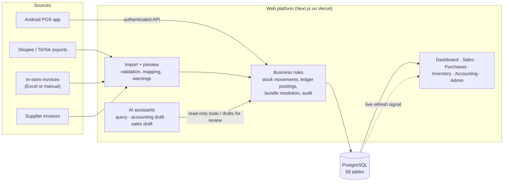

# Retail operations and analytics platform: a case study

A sales, inventory, purchasing and accounting platform I designed for my family's multi-outlet retail business,
which sells beauty products through physical stores and Shopee and TikTok shops (about 2,000 orders a month).
Staff and the owners use it day to day; historical data is still being imported and the design tuned for
real-world volume.

**This is a case study, not a code release.** The platform is private. Every screenshot and recording comes from
a demo copy running on **synthetic data**: brands, products, customers, suppliers and amounts are invented, and
the company name is blurred. The schema and SQL excerpts in [`snippets/`](snippets/) are taken from the real
system and checked against the demo database.


## The problem

Sales lived in marketplace exports, purchases in supplier invoices, and stock in spreadsheets updated by hand.
Almost every part of the operation had a data problem:

- **Stock counts drifted.** Each shop names listings its own way, often as bundles ("pick any 3 colours"), so
  one physical product sold under dozens of names, and bundles did not reduce the right stock.
- **Data was entered inconsistently.** Staff recorded the same thing in different ways, and purchase records did
  not always match what was actually paid against the supplier's receipt.
- **Invoices went missing,** so costs and supplier balances were incomplete.
- **There was no accountant,** so there was no reliable view of profit, cash or what was owed.
- **There was no way to monitor the business.** Answering "how did we do this month, and where?" meant
  assembling spreadsheets by hand, so it rarely happened.

## What I built

One PostgreSQL database (58 tables) that every sale, purchase and stock movement flows through, with
dashboards, accounting reports and three AI assistants on top.



| Area | What it does | Read more |
|---|---|---|
| **Architecture** | How requests, permissions, live refresh and audit work | [Architecture](docs/00-architecture.md) |
| **Dashboard and analytics** | Revenue, orders and AOV with period comparison; revenue by channel, platform, outlet, location, brand, category and province; best periods per item | [How the dashboard works](docs/01-dashboard.md) |
| **Data model** | Six areas: sales, products and mapping, purchases, inventory, accounting, reference data | [Data model](docs/02-data-model.md) · [all tables](snippets/schema-overview.md) |
| **Product mapping** | **7,100+ raw listing names mapped to 288 products** in the real data, including bundles | [Product mapping](docs/05-product-mapping.md) |
| **Imports, stock and ledger** | Previewed imports that flag what cannot be mapped; stock from counts plus movements; double-entry postings; balance sheet, income statement, monthly close | [Data flows](docs/03-data-flows.md) |
| **Workflows** | What staff do on each tab, step by step | [Workflows](docs/06-workflows.md) |
| **AI assistants** | A read-only assistant that answers business questions, and two that turn staff messages into draft entries for review | [AI assistants](docs/04-ai-assistants.md) |
| **Logic chains** | The core rules as diagrams and plain steps, each linked to its code excerpt | [Logic chains](docs/08-logic-chains.md) |
| **Build evidence** | Commit history, code volume, reconciliation checks, and a recording of the running demo | [Build evidence](docs/07-build-evidence.md) |

## How it is built

- **Database:** PostgreSQL on Supabase.
- **Application:** a web app (Next.js) on Vercel, plus an Android point-of-sale app that records in-store
  sales through the platform's authenticated API.
- **AI:** OpenAI API (GPT-5.4 and GPT-5.4 mini), using structured JSON output and function calling that the
  platform validates.

**My role.** I designed the data model, the business rules (mapping, bundles, stock movements, ledger postings,
the monthly close) and how the pieces connect. Most of the application code was written with AI coding
assistants (mainly OpenAI Codex) working to my specifications, and I reviewed and tested it.

## What I learned

- **Fix the grain first.** Most reporting errors came from mixing levels: a listing is not a product, a bundle is
  not one item, an order is not an order line. Getting those right in the schema fixed problems no report could.
- **Flag, don't guess.** Imports never guess a product: an unknown listing is kept, labelled "Unknown" and put
  in a review queue, so revenue stays complete while item-level reports wait for a human mapping.
- **Put trust signals next to the numbers.** Mapping health sits on the dashboard and missing import weeks on
  the sales page, so nobody reads a figure without knowing how complete it is.
- **Keep the model away from the data.** The AI only interprets language and picks from read-only tools;
  ordinary code does every read and write, which made the assistants safe to give to staff.

## Repository map

```
README.md                   this overview
docs/00-architecture.md     how the platform is put together
docs/01-dashboard.md        each dashboard section: the question, the metric definition, the design choices
docs/02-data-model.md       the six areas, what one row means in each, the grain rules, the ER diagram
docs/03-data-flows.md       import pipeline, bundle resolution, stock, ledger postings
docs/04-ai-assistants.md    how the three assistants work and why they cannot change data on their own
docs/05-product-mapping.md  how listing names become products and bundles
docs/06-workflows.md        what each tab is for and how staff use it
docs/07-build-evidence.md   commit history, code volume, reconciliation checks, demo recording
docs/08-logic-chains.md     the core rules as diagrams and plain steps, linked to the code excerpts
snippets/                   schema overview and short SQL/JSON excerpts from the real system
docs/images/                screenshots from the demo copy (synthetic data, company name blurred)
```

Not included: source code, real data, and anything identifying the business's customers or suppliers.
