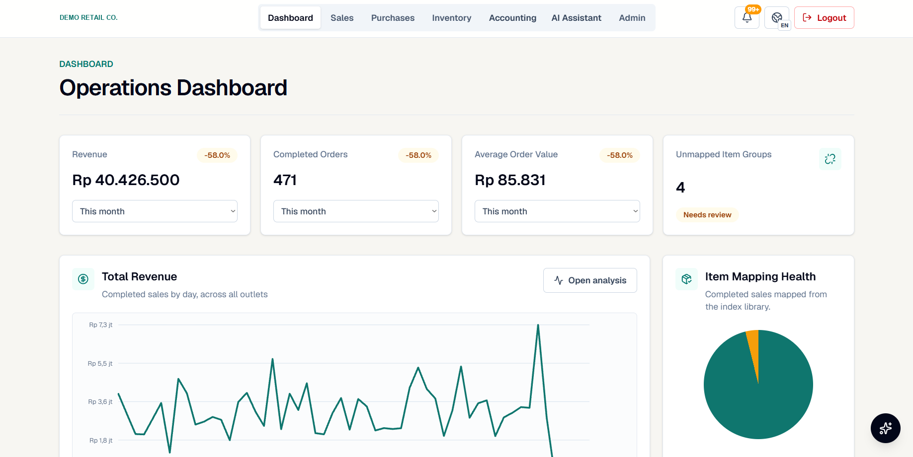

# Retail operations and analytics platform: a case study

A sales, inventory, purchasing and accounting platform I designed for my family's multi-outlet retail business,
which sells beauty products through physical stores and Shopee and TikTok shops (about 2,000 orders a month).
Staff and the owners use it day to day; historical data is still being imported and the design tuned for
real-world volume.

**This is a case study, not a code release.** The platform is private. Every screenshot comes from a demo copy
running on **synthetic data**: brands, products, customers, suppliers and amounts are invented, and the company
name is blurred.



## The problem

Sales lived in marketplace exports, purchases in supplier invoices, and stock in spreadsheets updated by hand.
Almost every part of the operation had a data problem:

- **Stock counts drifted.** Each shop names listings its own way, often as bundles ("pick any 3 colours"), so
  one physical product sold under dozens of names, and bundles did not reduce the right stock.
- **Data was entered inconsistently.** Staff recorded the same thing in different ways, and purchase records did
  not always match what was actually paid against the supplier's receipt.
- **Invoices went missing,** so costs and supplier balances were incomplete.
- **There was no accountant,** so there was no reliable view of profit, cash or what was owed.
- **There was no way to monitor the business.** Answering "how did we do this month, and where?" meant
  assembling spreadsheets by hand, so it rarely happened.

## What I built

One PostgreSQL database (59 tables) that every sale, purchase and stock movement flows through, with
dashboards, accounting reports and two AI assistants on top.

| Area | What it does | Read more |
|---|---|---|
| **Dashboard and analytics** | Revenue, orders and AOV with period comparison; revenue by outlet, platform, brand, category and item; best periods per item | [How the dashboard works](docs/01-dashboard.md) |
| **Data model** | Six areas: sales, products and mapping, purchases, inventory, accounting, reference data | [Data model](docs/02-data-model.md) |
| **Product mapping** | **7,100+ raw listing names mapped to 288 products** in the real data, including bundles | [Data model](docs/02-data-model.md) |
| **Imports, stock and ledger** | Staged imports that flag what cannot be mapped; stock as a history of movements; double-entry postings; balance sheet, income statement, monthly close | [Data flows](docs/03-data-flows.md) |
| **AI assistants** | A read-only assistant that answers business questions, and one that turns staff messages into draft entries for review | [AI assistants](docs/04-ai-assistants.md) |

## How it is built

- **Database:** PostgreSQL on Supabase.
- **Application:** a web app (Next.js) on Vercel, plus a point-of-sale app that sends in-store sales straight to
  the database.
- **AI:** OpenAI API (GPT-4o mini), returning structured JSON that the platform validates.

**My role.** I designed the data model, the business rules (mapping, bundles, stock movements, ledger postings,
the monthly close) and how the pieces connect. Most of the application code was written with AI coding
assistants (mainly OpenAI Codex) working to my specifications, and I reviewed and tested it.

## What I learned

- **Fix the grain first.** Most reporting errors came from mixing levels: a listing is not a product, a bundle is
  not one item, an order is not an order line. Getting those right in the schema fixed problems no report could.
- **Flag, don't guess.** Imports that stop and ask about unmapped rows are slower on day one and far cheaper than
  wrong stock found a month later.
- **Put trust signals next to the numbers.** Mapping health and missing import weeks sit on the dashboard, so
  nobody reads a revenue figure without knowing how complete it is.
- **Keep the model away from the data.** The AI only interprets language; ordinary code does every read and
  write, which made the assistants safe to give to staff.

## Repository map

```
README.md                  this overview
docs/01-dashboard.md       each dashboard section: the question, the metric definition, the design choices
docs/02-data-model.md      the six areas, what one row means in each, and the grain rules
docs/03-data-flows.md      import pipeline, bundle resolution, stock movements, ledger postings
docs/04-ai-assistants.md   how both assistants work and why they cannot change data
docs/images/               screenshots from the demo copy (synthetic data, company name blurred)
```

Not included: source code, real data, and anything identifying the business's customers or suppliers.
