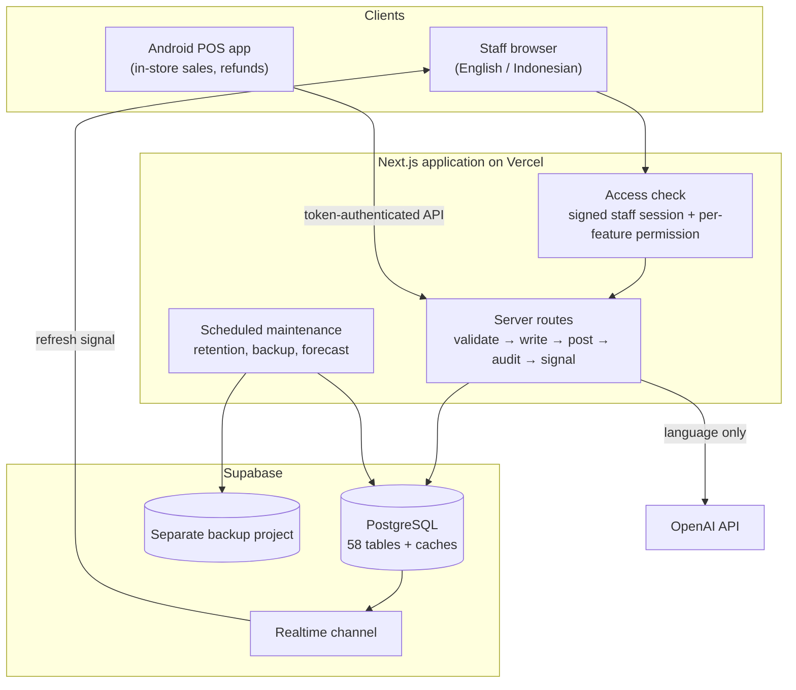

# 0. Architecture

One web application and one database. Every screen, import, assistant and the point-of-sale app goes through the
same server-side business rules, so a sale recorded on the shop floor and a sale imported from Shopee end up in
the same tables, move stock the same way and post to the same ledger.

## What happens on every change

Every write (an import, a refund, a mapping change, an accounting entry) follows the same five steps on the
server:

1. **Check access.** The staff session is verified and the request needs the right permission (for example
   *sales.write*, *inventory.mapping_manage* or *accounting.write*). Admins and moderators have extra rights;
   POS devices have their own login and can only record sales and refunds and look up stock.
2. **Validate.** Dates, outlets, invoice numbers, quantities and prices are checked. Duplicates and
   replacements need an explicit confirmation.
3. **Write the source records** (sale lines, purchase lines, counts, entries).
4. **Derive what depends on them:** stock movements, ledger postings, bundle components, dashboard and
   accounting caches. Derived data is always rebuilt from source records, never edited by hand.
5. **Record and signal.** One audit record per operation (who, what, when), and a short-lived "data changed"
   event so every other open browser refreshes the affected page.

## Design choices

- **Source records and derived data are separate.** Sales, purchases, counts and manual entries are the truth.
  Dashboard totals, ledger postings for sales and purchases, and period summaries are rebuilt from them, so a
  correction anywhere flows through everywhere.
- **Effective-dated rules.** Product costs, supplier payment methods (cash, deposit or credit) and marketplace
  fee rates each have a dated history. A change applies from its date onwards and never rewrites the past.
- **Personal logins, permissions per feature.** Staff get only the tabs they need; changing a password or
  disabling an account ends that person's open sessions.
- **Everything long-running reports progress.** Imports, rebuilds, backups and forecasts stream their stage
  and progress to a modal instead of freezing the page.
- **Bilingual by design.** Every label comes from an English/Indonesian catalogue, and an admin glossary can
  override business terms without a code change.

## Capabilities at a glance

| Tab | Main capabilities |
|---|---|
| Dashboard | Revenue, orders, AOV with period change; daily revenue chart; mapping health; contribution by category, brand and outlet; popular items; revenue analysis; sales analytics with per-item drill-down |
| Sales | Marketplace import (Shopee, TikTok), in-store invoice import and manual entry, POS export import, weekly import coverage, searchable sales history, refunds, export |
| Purchases | Supplier invoice import (batch) and manual entry, replacement on re-import, purchase history, export |
| Inventory | Index library (listing → product), bundle library, stock by location, stock transfers, physical counts, dated cost history, movement history per variant, low-stock alerts |
| Accounting | Ledger activity, opening balance plus 10 kinds of manual entry, balance sheet, income statement, monthly close checklist, receivables and payables by counterparty |
| AI Assistant | Accounting and in-store sales drafts from plain-language messages, with review before posting; business Q&A panel on every page |
| Admin | Users and permissions, staff activity history, backups and restore, data retention, outlets, suppliers, payment rules, fee rates, glossary, forecasting model |
