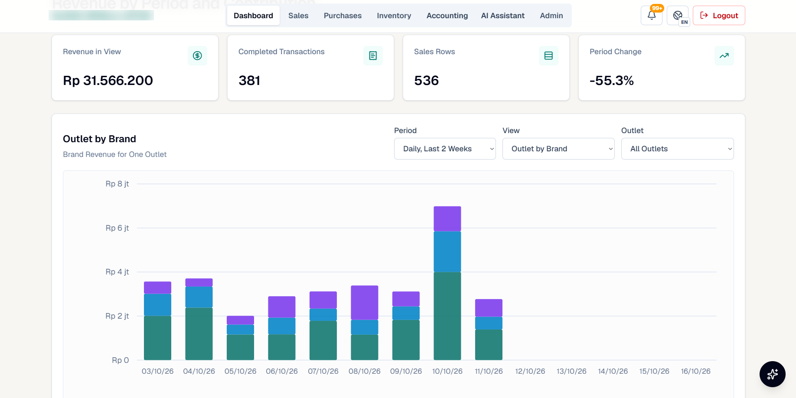
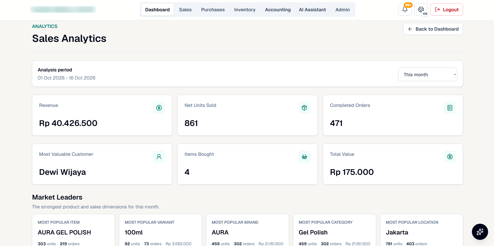

# 1. How the dashboard works

The dashboard answers the questions the owners asked every week, in the order they asked them: *how much did
we sell, is that up or down, where did it come from, and what sold best?* Every number on it is computed from
completed sales in the database, never typed in.

## Layout, top to bottom

| Section | Question it answers | Definition |
|---|---|---|
| **Revenue** card | How much did we sell? | Sum of net sales on completed sale lines, online and in-store, dated by when the order was placed (cancelled and in-transit lines count as 0) |
| **Completed orders** card | How many orders? | Count of distinct orders with at least one completed line |
| **Average order value** card | How big is a typical order? | Revenue ÷ completed orders |
| **Change badge** (e.g. −58.0%) | Is it up or down? | Change against the previous **full** period: this month so far against the whole previous month, this year so far against the whole previous year, last week against the week before |
| **Unmapped item groups** card | Can we trust the numbers? | Distinct listings (shop + raw name + raw variant) on completed sales that have no product, brand or category yet; "Needs review" until they are mapped |
| **Total revenue** chart | When did we sell? | Completed sales by day across all outlets, zoomable |
| **Item mapping health** | How much of the sales history is mapped? | Share of completed sale **lines** whose listing maps to a product, brand and category in the index library |

The **unmapped items** card is deliberately on the front page. Revenue is correct whether or not a listing is
mapped, but item, brand and category analysis is only as good as the mapping, so the dashboard says how much of
it to trust.

## Contribution and drill-down

**Revenue by period and contribution** splits the same revenue by any one dimension (channel, platform, outlet,
location, brand, category or province) over daily, weekly or monthly periods, optionally filtered to one outlet
or location. The example shows each outlet's revenue broken down by brand over the last two weeks.

**Sales analytics** ranks the leader in each dimension for the period: item, variant, brand, category,
location, outlet, province, weekday, week of month and month, each with units, orders and revenue. Selecting an
item opens the same breakdown for that item alone, which answers "when and where does this product sell best?"

## Design choices

- **One definition of revenue, two clocks.** The dashboard and analytics count a sale on the day the order was
  placed (what staff think of as "sales that day"); the ledger books it on the day it completed (when it becomes
  revenue in accounting). Totals agree exactly over time; a single month can differ by a percent or two.
- **Period comparisons use full previous periods.** A month in progress is compared with the whole previous
  month, so early in a month the badge usually shows a drop; the badge is read together with the period selector.
- **Customers are people, not orders.** "Most valuable customer" groups in-store sales by customer name (marketplace
  exports do not identify repeat buyers reliably).
- **Trust signals sit next to the numbers:** mapping health and unmapped items on the dashboard, incomplete
  import weeks on the sales page, instead of on a separate admin page.
