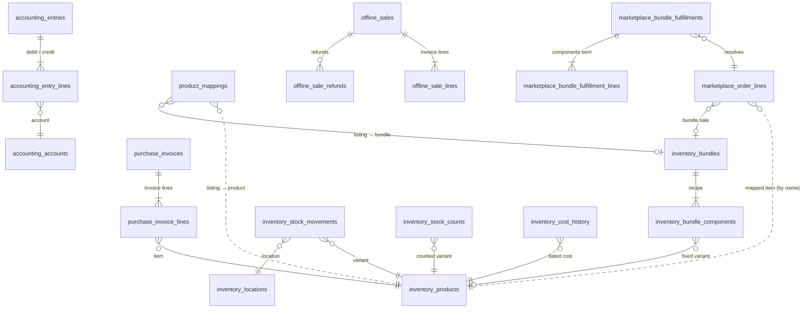

# 2. Data model

58 PostgreSQL tables and one view, grouped into six areas. The design rule throughout: **decide what one row
means before anything else**, because almost every reporting error in the old spreadsheets came from mixing
levels. Every table, with what one row means and its foreign keys, is listed in
[snippets/schema-overview.md](../snippets/schema-overview.md).

## The six areas

```
 Marketplace exports         Supplier invoices
        │                           │
        ▼                           ▼
 ┌──────────────┐  maps to  ┌──────────────┐
 │    SALES     │──────────▶│   PRODUCTS   │◀── index library: listing names → products
 │ order lines  │           │  + variants  │◀── bundle library: bundle → components
 └──────┬───────┘           └──────┬───────┘
        │ moves stock              │
        ▼                          ▼
 ┌──────────────┐           ┌──────────────┐
 │  INVENTORY   │◀──────────│  PURCHASES   │
 │  movements   │  receives │ invoice lines│
 └──────────────┘           └──────┬───────┘
        ▲                          │
        │ cost of goods            ▼
 ┌──────────────────────────────────────────┐
 │               ACCOUNTING                 │
 │ double-entry ledger, receivables,        │
 │ payables, monthly close                  │
 └──────────────────────────────────────────┘
```

| Area | One row means | Notes |
|---|---|---|
| **Sales** | one product line of one order, on one platform and outlet (online and in-store share one table) | Cancelled and returned lines are kept with their status and returned quantity; see the exceptions below |
| **Products** | one sellable variant of one product (e.g. a polish in one colour) | Brand and category are attributes of the product |
| **Product mapping** | one raw listing name (plus optional shop variation) on one platform and shop | Points to a product, or to a bundle whose recipe lists its components |
| **Purchases** | one line of one supplier invoice | Re-importing an existing invoice number needs an explicit confirmation and replaces it, so there are no duplicates |
| **Inventory** | one stock movement (sale, purchase, return, adjustment, transfer) | Stock on hand is the latest physical count plus every movement since, never a total edited by hand |
| **Accounting** | one ledger line (debit or credit) | Every posting path writes balanced lines; automatic and manual entries are labelled |

## The core relationships

Drawn from the real foreign keys. Dotted lines are links the application maintains by key or name rather than a
database foreign key (explained below).



## Schema design decisions

- **Keep the source text, copy the meaning.** A sale line keeps the listing name exactly as exported, and also
  stores the mapped product, variant, brand and category. Reports read one table with no joins; when the mapping
  library changes, the affected lines are re-labelled in one pass. A rename in a shop never loses history,
  because the raw name is always there to re-map from.
- **Source keys instead of foreign keys where sources differ.** A stock movement or ledger entry can come from a
  marketplace line, an in-store line, a purchase line, a count or a bundle component. Each stores
  `source_type` + `source_key`, with a unique index on the pair, so a rebuild can never post the same source
  twice.
- **Scoped identifiers.** Marketplace order numbers are only unique within a platform and shop, so the line key is
  `(platform, outlet, order_line_key)`, never the bare order number.
- **Dated history instead of overwrites.** Unit cost, supplier payment method and marketplace fee rate each live in
  a history table with an effective date, and every calculation looks up the value in force on the event's date.
- **Derived tables are disposable.** Dashboard and accounting summaries (11 tables) are caches with a "stale
  from" marker. They can be wiped and rebuilt from source records at any time, for example after a restore.
- **Constraints and database functions carry the rules that must never break:** non-zero stock movements, a bundle line must
  point at a bundle, a ledger line is either a debit or a credit, a monthly expense must be paid in cash,
  outlet and supplier codes are short upper-case codes.

## Grain rules that mattered

- **A listing is not a product.** Shops name the same item differently and rename listings, so sales keep the
  raw listing and the mapping decides the product. See [Product mapping](05-product-mapping.md).
- **A bundle is not one item.** A bundle line is resolved into its components for stock and cost. Where the
  customer picked the variants, the line waits as *pending choice* until staff assign them.
- **An order is not an order line.** Order counts use distinct orders; units and revenue use lines.
- **Stock is a history, not a field.** Stock is the last physical count plus the movements after it, so any
  number can be explained, and a wrong movement can be reversed instead of overwriting the total.

## What is kept and what is replaced

- **Kept:** cancelled lines (status *Cancelled*, zero revenue), returns (returned quantity and refund on the
  line), in-store refunds (separate refund records, optionally returning stock), cancelled POS sales (status
  only).
- **Replaced on purpose:** a marketplace export covers a 4-week window, so importing that window again replaces
  its lines with the newer file, so order statuses that changed since are picked up. A moderator can also delete a wrongly
  imported transaction; that removes its lines and stock movements and is recorded in the audit log.

## In numbers (real data)

- About **2,000 orders a month** across physical outlets, Shopee and TikTok.
- **7,100+ raw listing names** mapped to **288 products**.

The screenshots and examples in this repository use synthetic data.
