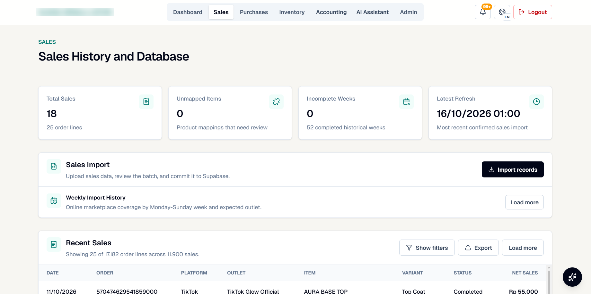
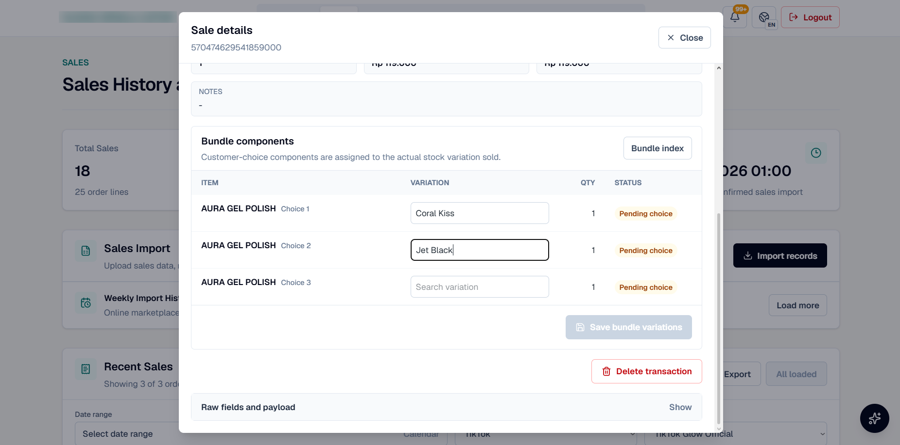
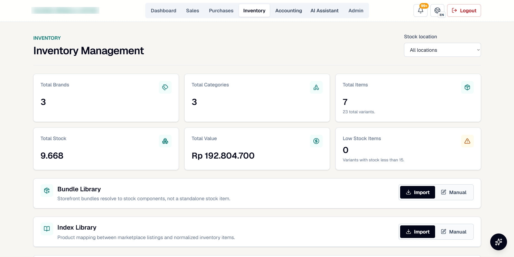
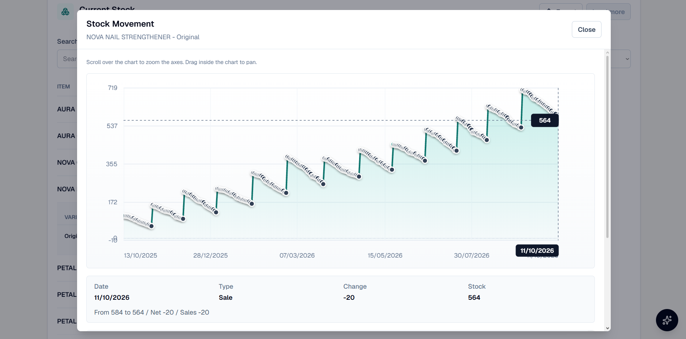
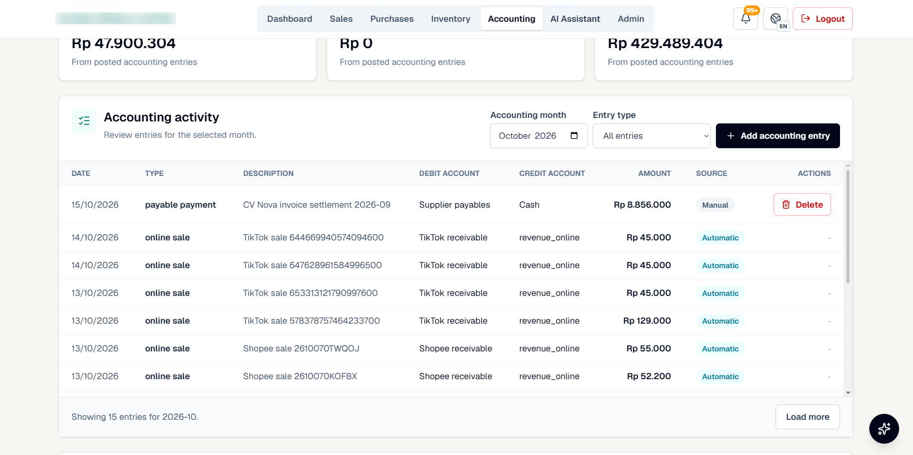
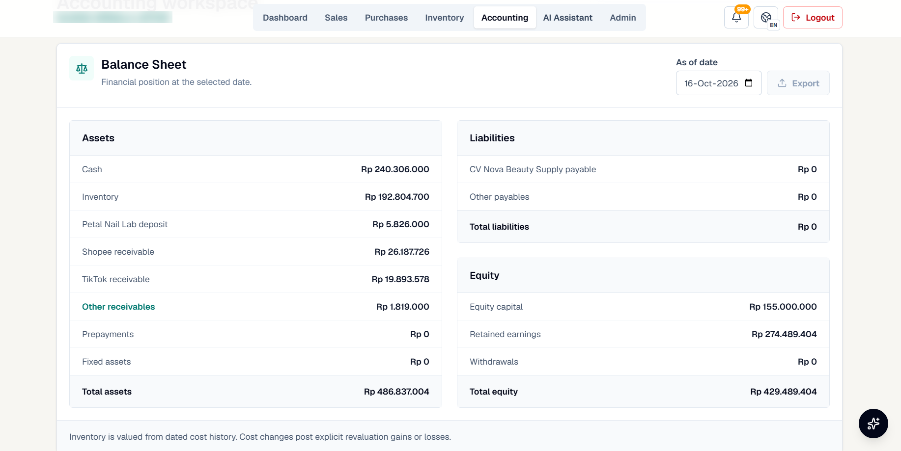
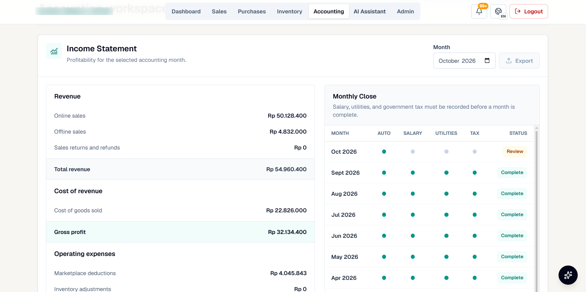

# 3. How data gets in, and where it goes

## Sales import



```
marketplace export (Shopee / TikTok)  or  manual in-store sale
        │
        ▼
 1. Stage      rows are loaded into a staging batch, nothing is written yet
        │
 2. Map        each listing name is looked up in the index library;
        │      unknown names are flagged, never guessed
        │
 3. Review     the batch shows totals, unmapped rows and duplicates
        │
 4. Commit     sale lines are written; stock movements and ledger lines are created from them
```

The header cards on the sales page are health checks for this flow: **unmapped items** (listings that need a
product), **incomplete weeks** (weeks where an outlet's export is missing) and **latest refresh**.

## Bundles



A bundle sale is split into its components using the bundle library. Fixed bundles resolve automatically.
Customer-choice bundles ("pick any 3 colours") stay **pending choice** until staff assign each component to the
variant actually sent, because the marketplace export does not say which colours were chosen.

## Inventory





Every committed sale, purchase, return and adjustment writes a stock movement. The movement history for a
variant shows each purchase stepping stock up and sales drawing it down, with the exact change behind any point.

## Accounting



| Event | Debit | Credit |
|---|---|---|
| Online sale completed | Platform receivable (Shopee / TikTok) | Online revenue |
| In-store sale (cash) | Cash | Offline revenue |
| Supplier invoice received | Inventory | Supplier payable |
| Supplier paid | Supplier payable | Cash |
| Monthly expense (e.g. electricity) | Expense account | Cash |

Entries created from sales and purchases are marked **Automatic**; anything entered by hand is marked
**Manual** and can be deleted, so the source of every number is visible.





The **monthly close** checklist shows whether salary, utilities and tax have been recorded. A month without
them would show an overstated profit, so it stays in *review* until they are in.
