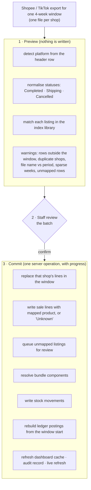

# 3. How data gets in, and where it goes

## Sales import

- **Status normalisation.** Each platform's own states are reduced to three business states. Only
  *Completed* lines count as revenue and move stock; *Shipping* (including delivered but still returnable) and
  *Cancelled* lines are kept with zero net value.
- **Unmapped listings never block an import.** Revenue is complete from day one: an unknown listing is saved as
  "Unknown", counted in the dashboard's *unmapped item groups*, and re-labelled automatically as soon as someone
  maps it.
- **In-store invoices** follow the same preview → confirm flow, from an Excel invoice (file name, invoice number,
  date, outlet code and item table are cross-checked) or a manual form. An existing invoice number needs an
  explicit replacement confirmation.
- **POS sales** arrive one at a time from the Android app through the platform's API and go through the same
  validation and posting code as a manual in-store invoice.

The header cards on the sales page are health checks for this flow: **unmapped items** (listings that need a
product), **incomplete weeks** (weeks where an outlet's export is missing) and **latest refresh**.

## Bundles

A bundle sale is split into its components using the bundle library. Fixed bundles resolve automatically.
Customer-choice bundles ("pick any 3 colours") stay **pending choice** until staff assign each component to the
variant actually sent, because the marketplace export does not say which colours were chosen. Bundle revenue is
split across the components' brands and categories in proportion to quantity, so brand reports stay correct.

## Inventory

| Event | Stock effect |
|---|---|
| Purchase line | + quantity at the receiving location |
| Completed online sale | − net quantity (after returns) |
| In-store sale | − quantity sold |
| Refund with "return to stock" | + returned quantity |
| Transfer | − at one location, + at the other |
| Physical count | becomes the new baseline; later movements add to it |

Stock on hand for a variant at a location is **the latest physical count plus every movement since**. The
movement history shows each purchase stepping stock up and sales drawing it down, with the exact change behind
any point. Unit cost is dated, so the cost of an old sale uses the cost in force on that day.

## Accounting

Sales and purchases post automatically; everything else is entered by staff (or drafted by the assistant).

| Event | Debit | Credit |
|---|---|---|
| Online sale completed | Platform receivable (Shopee / TikTok) | Online revenue |
| | Cost of goods sold | Inventory (at the dated standard cost) |
| | Marketplace charges | Platform receivable (the platform's dated fee rate) |
| In-store sale | Cash (cash, QRIS, transfer, debit) or other receivable (on credit) | Offline revenue |
| | Cost of goods sold | Inventory |
| Supplier invoice received | Inventory at standard cost (any price difference to a variance account) | Cash, supplier deposit or supplier payable, by the supplier's payment rule on that date |
| Supplier paid | Supplier payable | Cash |
| Marketplace payout | Cash | Platform receivable |
| Supplier deposit top-up | Supplier deposit | Cash |
| Monthly expense (salary, utilities, tax) | Expense account, dated month end | Cash |

Entries created from sales, purchases, counts and cost changes are marked **Automatic** and are rebuilt from
their source records whenever those change. Entries made by staff are marked **Manual**; they can be deleted by
their author or an admin (except the opening balance and rent schedules), so the source of every number is
visible.

The **monthly close** checklist shows whether salary, utilities and tax have been recorded. A month without
them would show an overstated profit, so it stays in *Review* until they are in, then shows *Complete*.
