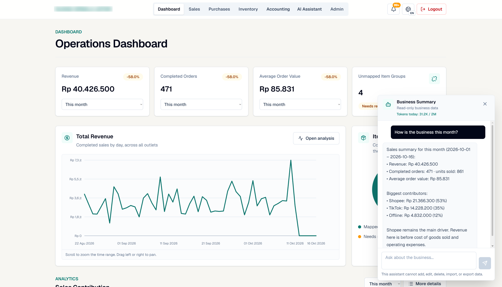
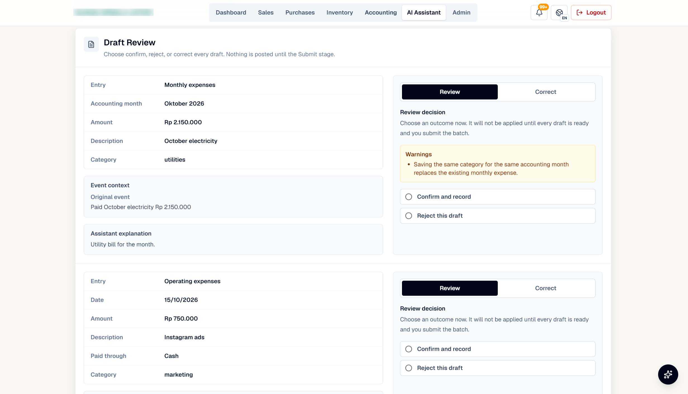

# 4. AI assistants

Three assistants use the OpenAI API: a **query assistant** (GPT-5.4 mini) that answers business questions, and
two **entry assistants** (GPT-5.4) that turn staff messages into accounting or in-store sale drafts. In all
three, **the model only interprets language**. Reading and writing data is done by the platform's own code, with
the same rules as the rest of the app.

```
 staff message ──▶ model: interpret ──▶ tool call / structured JSON ──▶ platform code ──▶ database
                   (no database access)       (validated)              (normal rules)
```

> **Screenshots:** the demo copy has no OpenAI key, so its model calls are answered by a local stand-in that
> returns the same format. The tools, validation and draft review shown are the real platform code; the wording
> of the answers is templated. See [Build evidence](07-build-evidence.md).

## Query assistant (read-only)



The assistant sits in a panel on every page. It works by **function calling**:

1. The model sees the question and a fixed list of 8 read-only tools: sales summary, top items or variants,
   sales trend, purchase summary, purchase trend, inventory health, financial position, and volume forecast
   ([full list](../snippets/06-query-assistant-request-types.json)).
2. It chooses one or more tools and fills in their parameters (period, breakdown, metric) as structured
   arguments, which the platform validates against fixed options.
3. The platform runs each tool on its own queries and returns the numbers. The model can ask for more data,
   up to three rounds.
4. The model writes a short answer from the returned numbers only.

There are no write tools, so it cannot add, edit, delete, import or export data. It is instructed to answer
only from tool results and, when a question is outside what the tools cover, to say what it cannot answer and
suggest a question it can. That is a prompt instruction, not a hard block, so the worst case is a weak answer,
never a changed number. Forecasts are units only, and a low-confidence forecast is shown only after the user
explicitly asks for it anyway. A daily token budget is shown in the panel.

## Entry assistants (drafts only)



1. A staff member writes what happened in plain language, for example that the October electricity bill and some
   Instagram ads were paid in cash, or that a customer bought two polishes in the store today.
2. The model splits the message into separate events and returns them as structured JSON in a strict schema
   ([accounting schema](../snippets/05-entry-assistant-schema.json)): entry type, date, amount, category,
   payment method and supplier for accounting; date, outlet, customer, items, quantities and prices for sales.
3. The platform validates each event with its own rules (dates inside the reporting period, known suppliers and
   outlets, amounts above zero, allowed payment methods) and matches sale items to real products by text
   similarity, letting the model choose only among the platform's own candidate products.
4. Anything unclear becomes a **question back to the staff member**, not a guess. Clear events become **drafts**.
5. A person confirms, corrects or rejects each draft. **Nothing is posted until the batch is submitted**, and
   submitting goes through exactly the same code path as a manual entry.

The review screen shows the original message next to each draft and warns when a draft would replace an
existing entry (for example, a second electricity bill for the same month) or is unusually large.

## Why this design

- **Staff-safe.** A wrong interpretation produces a draft someone rejects, not a wrong number in the ledger.
- **Auditable.** Every posted entry went through the same code path as a manual one, and every submission or
  rejection is recorded.
- **Bounded cost.** The models only classify, extract and summarise small tool results; they never reason over
  the whole database, and a daily token limit caps spending.
