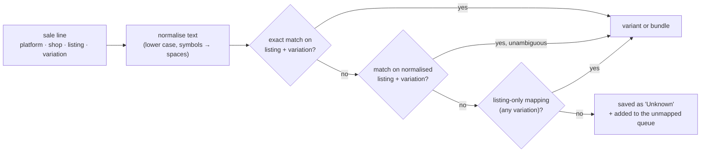

# 5. Product mapping

The hardest problem in the old spreadsheets was identity: one physical polish was sold under dozens of names,
because every shop writes its own listing titles, renames them, and sells the same items again inside bundles.
The mapping layer turns any listing into either **one stock-tracked variant** or **one bundle recipe**.

## Three levels of identity

| Level | Example (synthetic) | Who owns it |
|---|---|---|
| **Listing**: what the shop exported | "AURA Kutek Gel UV/LED 10ml Tahan Lama Halal" + shop variation "Cherry Red" | the marketplace and the shop admin |
| **Product family**: normalised item | AURA GEL POLISH (brand AURA, category Gel Polish) | the business |
| **Variant**: the thing that has stock | AURA GEL POLISH / Cherry Red, with its own index code | the business |

Stock, cost and accounting are always at the **variant** level. Reports can roll up to product family, brand or
category. The shop's own variation name is only a *matching condition*: two shops can call the same colour
"Merah Cherry" and "Cherry Red" and still reach the same variant.

## The index library

One row per **platform + shop + listing name + optional shop variation**, pointing at a variant (or at a bundle).
It is maintained as a spreadsheet that staff import, or edited one mapping at a time in the app.

- **No fuzzy matching and no AI.** If two mappings would match the same normalised name, neither is used and
  the line stays unmapped. A wrong automatic match would silently move the wrong stock; an unmapped line is
  visible and costs one click to fix.
- **Listing-only mappings** cover shops where every variation is the same stock item, so one row can map
  hundreds of colour-named listings.

### Validation on import

An index library import is rejected, with the row number, when:

- a required field is missing (normalised name, listing name, platform, shop, actual variation, brand, category),
- the platform and shop are not configured in Admin,
- two rows map the same listing and variation to different targets,
- one index code points to two different products, or one variant gets two index codes,
- a bundle row names a bundle code that is defined twice.

Changes that would re-point existing mappings are shown as warnings first, and need acknowledging.

## The unmapped queue

Unmapped sale lines are grouped by listing (platform, shop, listing name and variation) with an occurrence
count and first/last-seen dates, so staff map the most frequent names first. When a mapping is added, every
matching historical line is re-labelled, and stock movements, ledger postings and dashboard figures are rebuilt
for the affected dates. The dashboard's *unmapped item groups* card counts what is left.

## Bundles

A bundle mapping points a listing at a **bundle code** instead of a variant. The bundle library defines the
recipe:

| Component | Mode | Example |
|---|---|---|
| Fixed item, fixed variant | always the same stock item | Starter kit: 1 × Base Coat, 1 × Top Coat, 1 × Cuticle Oil (Lavender) |
| Fixed item, customer's choice of variant | customer picks, from all or from an allowed list | Trio: 3 × any AURA gel polish colour |

The bundle has a total unit count: fixed components may not exceed it, customer-choice components must be able
to fill the rest, and a fixed component must name a variant.
When a bundle sells:

1. Fixed components resolve to stock movements and cost of goods immediately.
2. Customer-choice components wait as **pending choice** (the export does not say which colours were sent),
   and appear in a work queue until staff assign the variants. Stock and cost then follow.
3. Revenue from the bundle is attributed to its components' brands and categories in proportion to quantity,
   so brand and category reports include bundle sales.

## In numbers (real data)

**7,100+ raw listing names** mapped to **288 products**, across physical outlets, Shopee and TikTok.
