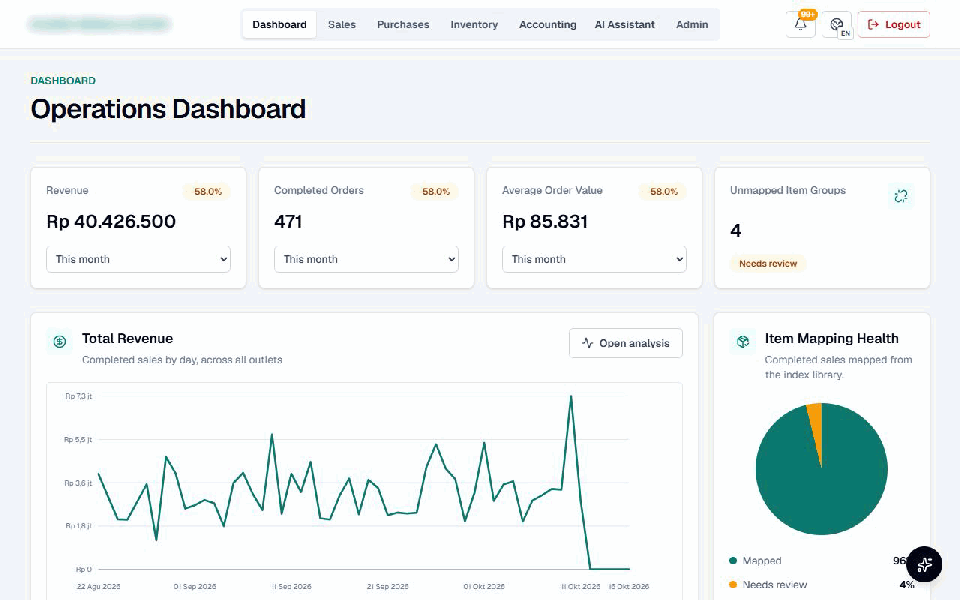
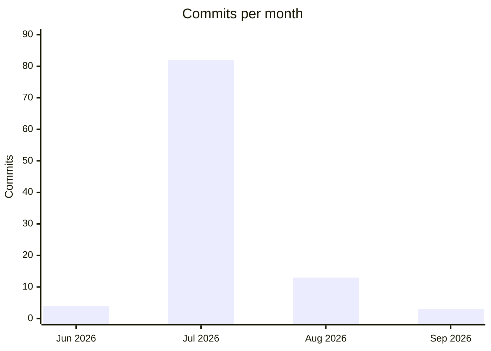

# 7. Build evidence

The source code is private, so this page collects what can be shown without it: the build history, the size of
the system, a recording of the running demo, and checks that the numbers on different screens agree.

## The running demo

Recorded from the demo copy. The data is synthetic and the company name is blurred. The sequence:

1. Dashboard: revenue, orders and AOV, daily revenue, mapping health, contribution by category, brand and
   outlet, popular items.
2. Business Summary panel: "Which items sold best last week?" is answered from the platform's read-only tools.
3. Accounting assistant: one message becomes two separate drafts (a monthly utilities expense and a cash
   marketing expense), with the replacement warning, waiting for review.
4. Inventory: stock and value per item, expanded to variants with their dated costs.

**About the AI in the demo.** The demo has no OpenAI key. Its three model calls are answered by a local
stand-in that returns the same response format, while everything around them is the real platform code: the
tool calls and their queries, product matching, validation, draft review and posting. Answers in the demo are
therefore templated; in production they are written by the model from the same tool results.

## How the demo was built

- **Same structure as production.** The demo database was created from a structure-only export of the
  production schema (no data): 58 tables, 1 view, 52 functions, 9 triggers, 156 indexes, all matching.
- **Data entered through the application, not into tables.** A generator produced one year of fictional
  activity (3 brands, 23 variants, 2 bundles, 3 shops, 3 suppliers; about 15,200 marketplace order lines,
  1,383 in-store invoices, monthly restocks, a supplier price rise, payouts and monthly expenses) and sent it
  through the same server endpoints the import screens use, in 4-week batches, exactly as staff would. Every stock
  movement, ledger posting and dashboard figure in the screenshots was produced by the platform itself.

## Build history

| Measure | Value |
|---|---|
| Commits (main branch) | 102, from 27 June to 17 September 2026, on 32 separate days |
| Application code | about 34,700 lines of TypeScript (108 `.ts` + 42 `.tsx` files) |
| Database code | about 7,150 lines of SQL across 64 schema-change files |
| Server routes | 65 |
| Screens | 15 pages |
| Business-logic modules | 41 |

Most of the code was written by AI coding assistants working to my specifications; I specified, reviewed
and tested each change, and committed it.

## Numbers that must agree, and do

Checked on the demo database:

| Check | Result |
|---|---|
| Revenue on the dashboard (all time) vs revenue accounts in the ledger | Rp 1,008,992,050 = Rp 1,008,992,050 |
| Dashboard card "this month" vs the SQL in [snippets/04](../snippets/04-dashboard-revenue-aov.sql) | Rp 40,426,500 · 471 orders · AOV Rp 85,831, identical |
| Stock on hand from [snippets/03](../snippets/03-stock-on-hand.sql) vs the production view | 23 variants, 9,668 units, 0 differences |
| Ledger entries without lines, or not balancing | 0 and 0 |
| Dashboard contribution panels (category, brand, outlet) vs database sums | identical after the fix below |

## What testing at volume found

Running a year of data through the real import path is also a load test, and it found problems that small
test files never showed:

- **Charts silently capped.** The database API returns at most 1,000 rows per request, so with more than about
  100 days of data the category, brand and outlet panels were built from a partial set. **Fixed:** the
  dashboard now reads its summary tables page by page in a stable order, verified against database sums.
- **Stock lost across import windows.** Orders placed at the end of one 4-week export and completed in the
  next lost their stock movement when the next window was imported, so stock on hand was overstated.
  *Open; fix planned.*
- **Rebuilds that stop halfway.** If an accounting rebuild fails part-way, it can leave entries without lines.
  *Open; fix planned,* together with stable ordering for every paged read.
- **Import time grows with history,** because each import rebuilds the ledger from its window to today. This is
  the next optimisation.
