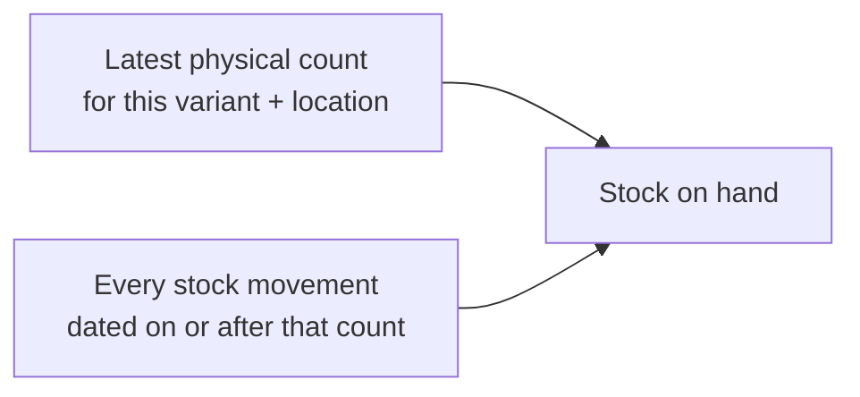
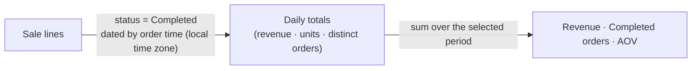
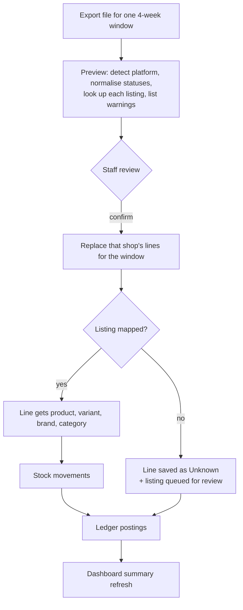
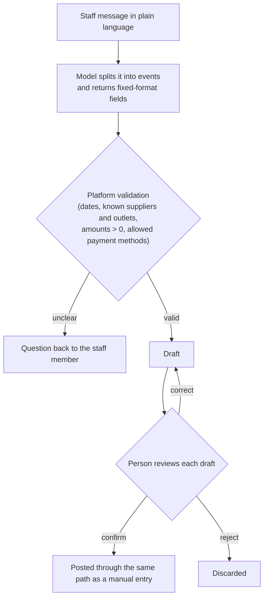

# 8. Logic chains

How the core rules work, as diagrams and plain steps. Each section links to the matching code excerpt in
[`snippets/`](../snippets/), so you can read the design first and the code as evidence.

## 1. Stock on hand



```
for each variant and location:
    baseline   = the most recent physical count (0 if never counted)
    movements  = sum of all stock changes since that count's date
                 (+ purchases, − sales, + returns to stock, ± transfers, ± adjustments)
    on hand    = baseline + movements
```

Why: stock is never typed in as a total. A count resets the baseline, and everything after it is explained by a
recorded movement, so any number can be traced back to the sales and purchases behind it.

**Code:** [stock-on-hand view](../snippets/03-stock-on-hand.sql) · [stock movement table](../snippets/02-stock-movement-table.sql)

## 2. Revenue, orders and AOV on the dashboard



```
daily totals:   for each day, from completed lines only
                    revenue  = sum of net amounts
                    orders   = count of distinct orders (platform + outlet + order number)
card:           revenue  = sum of daily revenue in the period
                orders   = sum of daily orders        (an order belongs to exactly one day)
                AOV      = revenue ÷ orders
change badge:   this month so far   vs  the whole previous month
                this year so far    vs  the whole previous year
                last week           vs  the week before
```

Why daily totals: the dashboard reads a small summary table instead of every sale line, and it is rebuilt from
the sale lines whenever an import changes them.

**Code:** [daily totals and the card query](../snippets/04-dashboard-revenue-aov.sql)

## 3. A marketplace import



Why: an unknown listing never blocks the import or drops revenue. It is counted on the dashboard as an
*unmapped item group* and re-labelled automatically once someone maps it.

**Code:** [sale line table](../snippets/01-sales-order-line-table.sql)

## 4. A bundle sale

```
bundle line arrives
    look up the bundle's recipe
    for each component:
        fixed variant      → assign it automatically
        customer's choice  → mark "pending choice" until staff pick the variant actually sent
    when every component has a variant:
        write one stock movement per component
        split the bundle's revenue across the components' brands and categories by quantity
```

## 5. An entry assistant message



What the model returns for each event, as fields with fixed allowed values:

| Field | Allowed values |
|---|---|
| Status | draft, or needs clarification (with a question) |
| Confidence | high, medium, low |
| Entry type | capital, loan, marketplace payout, other receivable, supplier deposit, rent prepayment, fixed asset, operating expense, monthly expense, supplier payment |
| Expense category | salary, utilities, tax, marketing, petty cash, subscription, travel, other |
| Payment method | cash, loan |
| Plus | date, amount, description, platform, supplier code, rent start and length where relevant |

Because every field has a fixed set of values, the model cannot invent a new account or category; the platform
rejects anything outside the list.

**Code:** [output schema](../snippets/05-entry-assistant-schema.json)

## 6. A query assistant question

```
question arrives
    model sees 8 read-only tools:
        sales summary · top items/variants · sales trend · purchase summary · purchase trend
        inventory health · financial position · volume forecast
    model picks tool(s) and fills arguments from fixed options
        (period: today / this week / last week / this month / last month / this year / all time;
         breakdown: platform / outlet / brand / category / province / supplier …)
    platform validates the arguments and runs its own queries
    model may ask for more data, up to 3 rounds
    model writes the answer from the returned numbers only
```

There are no write tools, so the worst a bad answer can do is be unhelpful; it cannot change a number.

**Code:** [the 8 tools and their arguments](../snippets/06-query-assistant-request-types.json)
